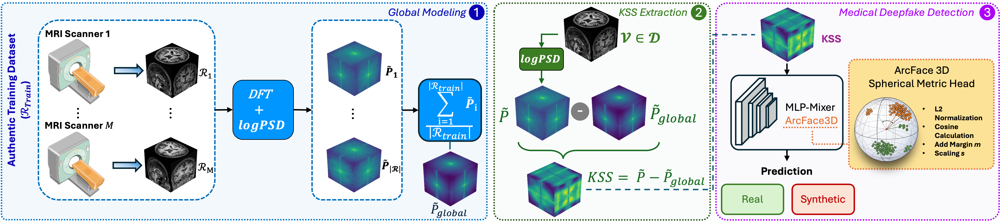
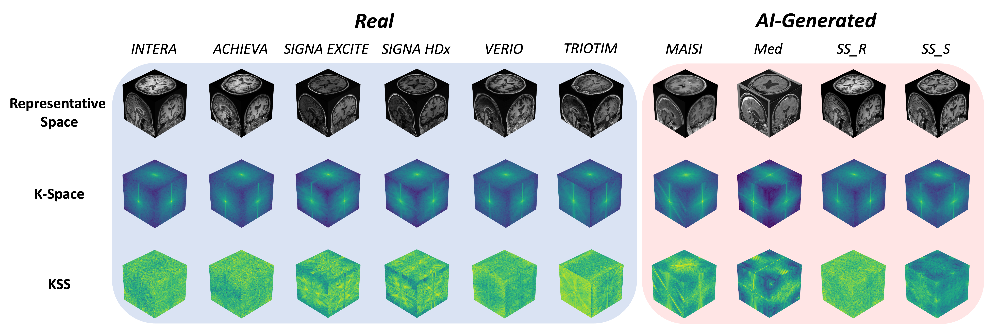

# The K-Space Signature: Frequency-Domain Representation Learning for Medical Deepfake Detection



This repository contains the official codebase for the forensic framework designed to distinguish authentic 3D MRI volumes from entirely synthetic generated medical images. 

## Overview

Modern generative models, such as MAISI and Med-DDPM, produce fully synthetic 3D MRI volumes that are visually indistinguishable from authentic scans. Automatically detecting these forgeries is critical to prevent diagnostic fraud and protect the integrity of uncorrupted clinical datasets. 

This framework shifts the forensic analysis from the conventional spatial domain to the frequency domain. We introduce the **K-Space Signature (KSS)**, a novel representation obtained by subtracting an empirical global anatomical prior—computed as the average spectral volume in the Logarithmic Power Spectral Density (Log-PSD) domain. This process suppresses anatomical variance to expose acquisition- and generation-specific fingerprints that manifest as systematic, higher-frequency spectral deviations. 

Because standard Convolutional Neural Networks (CNNs) struggle to capture the globally distributed artifacts inherent to frequency-domain signals, this repository also implements a new 3D version of the MLP-Mixer architecture tailored for the spectral domain, equipped with an ArcFace metric-learning head.

## Dataset



Our dataset consists of both authentic MRI scans and synthetic volumes generated by state-of-the-art diffusion models. This visual comparison highlights the differences across the spatial and frequency domains, showcasing the distinct higher-frequency spectral deviations our framework aims to detect.

## Repository Structure

Please place all provided Python scripts into the **`src/`** directory. The modular codebase is structured around the following core components:

*   **Datasets**: Custom data loaders, including `KPrintDataset`, `KSpace_Dataset`, and `RealFake_KSpace_Dataset`.
*   **Preprocessing**: Integration with native MONAI pipelines to ensure the preservation of physical metadata, apply safe anatomical reorientation, and perform dynamic KSS harmonization (global spectrum subtraction).
*   **Model Architectures**: Implementations of both spatial and frequency domain classifiers.
*   **3D CNNs**: Highly optimized volumetric versions of ResNet, MobileNetV2, and ShuffleNetV2.
*   **Spectral Networks**: Implementations of `KSpaceMLPMixer3D`, `KSpaceMLPMixer3D_ArcFace`, and anomaly detection via `KSpaceFlowDetector`.
*   **Training Frameworks**: Dedicated trainer classes (e.g., `ModelTrainer`, `KSpaceModelTrainer`, `RealFakeTrainer`, and `KSpaceFlowTrainer`).
*   **Experiment Tracking**: Automated Weights & Biases (WandB) integration, automatic confusion matrix generation, and advanced latent space topology visualization using t-SNE and UMAP.

## Installation

The required dependencies and system libraries are bundled in the provided `environment.yml` file. The environment utilizes Python 3.9.18 and includes heavy-duty scientific libraries such as PyTorch, MONAI, and the CUDA 12.4 toolkit.

1.  Clone this repository to your local machine:
    ```bash
    git clone <your-repository-url>
    cd <your-repository-directory>
    ```
2.  Create the Conda environment using the provided configuration:
    ```bash
    conda env create -f environment.yml
    ```
3.  Activate the environment:
    ```bash
    conda activate kprint
    ```
